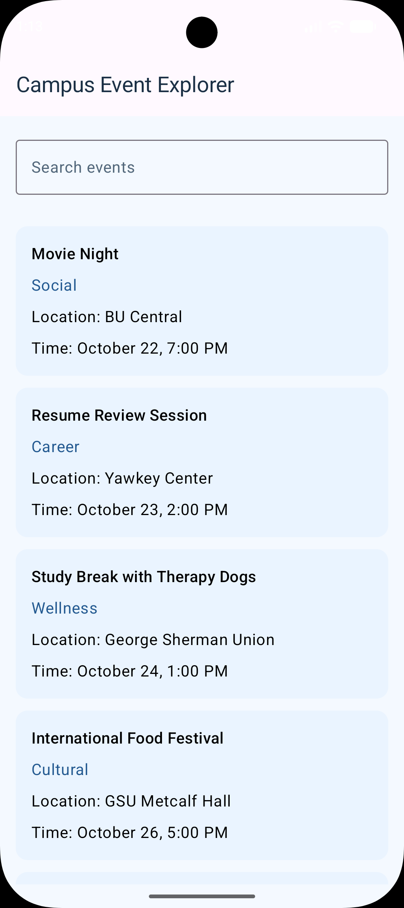
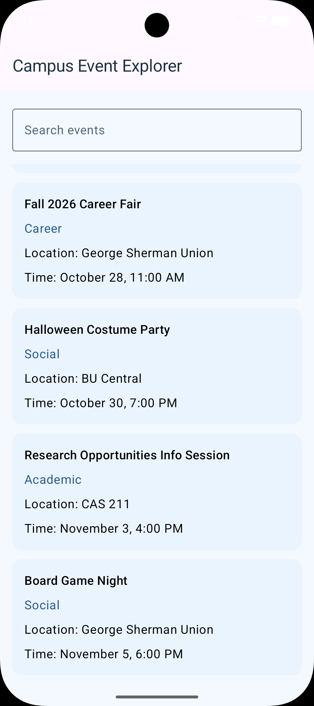
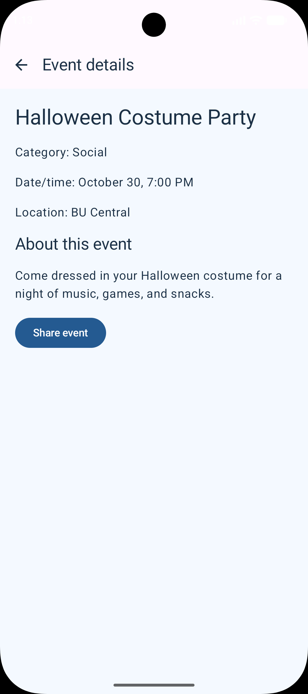

## Assignment 3: Campus Event Explorer
**Name:** Namratha Reddy  
**BU ID:** U65966062  
**Course:** CS-501 E1

### Description:
Campus Event Explorer is an Android application built using Kotlin, Jetpack Compose and Material 3. It allows users to browse campus events, search for events by title or category, view more information about an event and share the event details with other applications

### How to Run:
1. Clone or download this repository
2. Open the project in Android Studio
3. Allow Gradle to sync
4. Start the Android emulator or connect an Android device
5. Run the app by clicking the Run button

### Screenshots:

**Event List:**

**Filtered Event List:**

**Event Detail:**

### Navigation and State:
I used an event ID in the navigation route instead of passing the entire CampusEvent object because the detail screen only needs the ID to find the corresponding event from EventRepository. This avoids passing unnecessary data between screens. AppNavigation owns the search state and passes the query and onQueryChange callback to EventListScreen. I used rememberSaveable to preserve the search text when the device is rotated. The filtered events are calculated from the query, rather than storing a separate list. When a user selects an event, EventDetail is added to the navigation back stack. Pressing the system Back button or the Up button removes the detail screen and returns to the event list. The UI screens don't directly access the NavController. Instead, they use callbacks like onEventSelected and onBack, while AppNavigation handles the actual navigation. The Share button uses an implicit ACTION_SEND intent because it doesn't specify which application should receive the event details. Intent.createChooser() allows the user to select an application to share the information with

### Collaboration and Generative-AI Disclosure:
I didn't collaborate with anyone for this assignment. I used Gemini 3.6 Flash to ask questions like, "why do we need @Serializable for screens and how does the detail screen know which event I clicked on", "why do we pass event ids instead of complete objects", "how to preserve search state between screens, how do implicit intents work". Also I used it to help with Kotlin syntax

#### -Relevant suggestions produced:
It suggested keeping navigation logic in AppNavigation and using callbacks to communicate between screens

#### -What I accepted, changed, or rejected:
Unlike the previous assignment which only had one screen, I learned how to navigate between multiple screens using type safe routes and manage the back stack. I followed the callback approach to keep navigation separate from the UI and used rememberSaveable to preserve the search text. I also added verticalScroll() after testing the app in landscape mode

#### -Verification:
I tested searching, selecting events, navigating back using both the Up and system Back buttons and sharing event details. I also rotated the emulator to confirm that the detail screen remained visible, could scroll and that the search text was preserved when returning to the list

### Verification:
I tested the application in Android Studio using an emulator, Pixel 9. I searched for events by title and category, selected an event and rotated the emulator to check that the detail screen remained visible. I also checked that the detail screen could scroll in landscape mode. After pressing Back, I verified that the search text was still there. I then selected another event and tested the system Back button. I also tested the Share button to check that the Android share sheet opened with the event information.